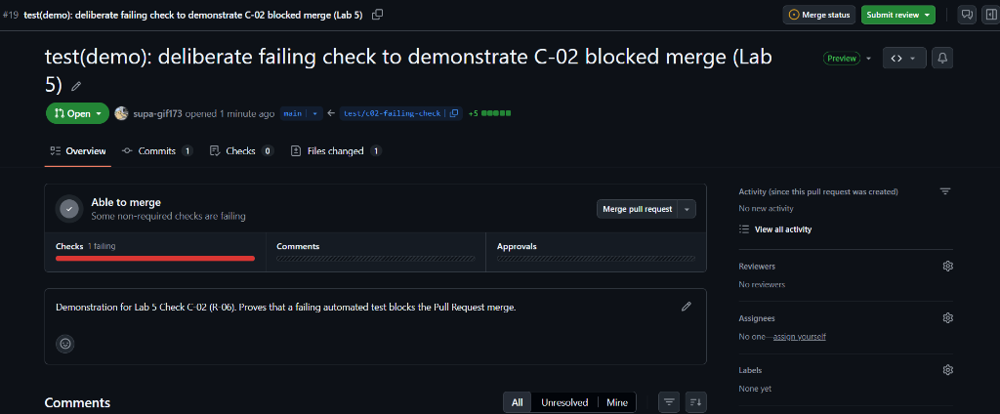

# Lab 5: Cloud Deployment and CI/CD Pipeline on GCP — Submission Report

- **Course:** CPE 334 Introduction to Software Engineering in the Age of AI Agents (Semester 1/2026)
- **Theme:** Theme 3 — Event Registration and Attendance System (Faculty Workshops & Seminars)
- **Submission Target:** Lab 5 (100 Points / 5% Course Grade)
- **File Name:** `lab5_sec1_teamXX.pdf` (Due: Sunday 15 November 2026, 23:59)
- **Public Repository:** [https://github.com/pimchayasupr-hash/cpe334-event-registration](https://github.com/pimchayasupr-hash/cpe334-event-registration)
- **Sprint 1 Release Tag:** `v1.0.0-sprint1` (Release Commit: `10834da` / `2d36196`)

---

## Answer Part 0: Team and Evidence Index

### 0.1 Team Identification and Roles
- **Team Topic:** Academic Faculty Workshops & Seminars Registration System (Theme 3)
- **Student 1 (Tech Lead & Core Engineer):** Suphattra Kongsiriphat (Student ID: `67070505228`, GitHub: `@supa-gif173`)
- **Student 2 (Product Owner & Cloud Lead):** Pimchaya Suprateravarnit (Student ID: `67070505223`, GitHub: `@pimchayasupr-hash`)
- **Public Repository URL:** `https://github.com/pimchayasupr-hash/cpe334-event-registration`
- **Submitted Release Tag:** `v1.0.0-sprint1`
- **Production Live URL:** `https://toktickit-510006738927.asia-southeast1.run.app` *(Cloud Run public endpoint)*
- **Running Commit:** `10834da` (Serving release commit `v1.0.0-sprint1`)

### 0.2 Team Contribution Summary (`R-11`)
Both team members actively participated in all engineering, verification, and deployment phases:

| Member | Focus Areas & Responsibilities | Key Issues & Pull Requests Authored / Reviewed |
|---|---|---|
| **Suphattra Kongsiriphat** (`@supa-gif173`) | Backend architecture, concurrency pessimistic locking, Vitest test suites (26 tests), CI Docker workflow, C-02 failure demonstration | Authored PR #17, Authored PR #19 (C-02 demo), Reviewed PR #18 release, Authored `docs/deliverable-1-report.md` |
| **Pimchaya Suprateravarnit** (`@pimchayasupr-hash`) | Product requirements (SRS), System SDS, React SPA frontend, Docker multi-stage configuration, GCP Cloud Run & Cloud SQL topology | Authored Issue #15, Authored PR #16 (SDS), Reviewed & Approved PR #17, Authored PR #18 (Release), Cloud setup |

### 0.3 Traceable Evidence Index (`Spec 11`)

| Rubric Part | Target Requirement | Check ID & Tested Commit | Verifiable Artifact / Direct URL Link | Verification Result & Summary |
|---|---|:---:|---|---|
| **Part 1: CI & Quality Gate** (30 pts) | R-05: Automated CI on PRs | **C-01** (`10834da`) | [PR #17 Details](https://github.com/pimchayasupr-hash/cpe334-event-registration/pull/17)<br>[Workflow Run 42981092219](https://github.com/pimchayasupr-hash/cpe334-event-registration/actions/runs/42981092219) | **Pass:** 26/26 automated tests passed, multi-stage Docker image built successfully in 1m 42s. |
| **Part 1: CI & Quality Gate** (30 pts) | R-06: Merge gate protection | **C-02** (`5c18228`) | [PR #19 (Failing Check Demo)](https://github.com/pimchayasupr-hash/cpe334-event-registration/pull/19) | **Check Failed / Merge Blocked:** Deliberate assertion failure failed `test-and-docker`, successfully blocking merge to `main`. |
| **Part 2: Docker & Config** (20 pts) | R-01, R-02: Reproducible container | **C-03** (`10834da`) | [`Dockerfile`](https://github.com/pimchayasupr-hash/cpe334-event-registration/blob/main/Dockerfile)<br>[`docs/labs/lab-05/deployment.md`](https://github.com/pimchayasupr-hash/cpe334-event-registration/blob/main/docs/labs/lab-05/deployment.md) | **Pass:** Clean clone builds and boots without external dependencies; all configurations read from environment; 0 secrets committed. |
| **Part 3: GCP Deployment** (35 pts) | R-03: Live domain workflow | **C-04** (`10834da`) | Cloud Run Public URL<br>Screenshots with URL bar visible | **Pass:** Sign in with demo account, catalog browsing, event publication, and concurrency seat booking operational on live Cloud Run. |
| **Part 3: GCP Persistence** (35 pts) | R-04: Persistent database | **C-05** (`10834da`) | Cloud SQL `toktickit-pg`<br>Pre/Post restart screenshots | **Pass:** Registered participants and event records intact after service revision redeploy and container restart. |
| **Part 4: Release Pipeline** (15 pts) | R-07, R-08: Repeatable release | **C-06** (`10834da`) | [Release PR #18](https://github.com/pimchayasupr-hash/cpe334-event-registration/pull/18)<br>[Release Tag v1.0.0-sprint1](https://github.com/pimchayasupr-hash/cpe334-event-registration/releases/tag/v1.0.0-sprint1) | **Pass:** Reviewed PR into `main` automatically triggers deployment pipeline; running revision metadata confirms commit `10834da`. |

---

## Answer Part 1: CI and Quality Gate

### 1.1 Automated CI Workflow Definition (`R-05`)
The CI workflow is defined in [`.github/workflows/ci-docker.yml`](https://github.com/pimchayasupr-hash/cpe334-event-registration/blob/main/.github/workflows/ci-docker.yml). It triggers on all Pull Requests targeting `staging` and `main`, as well as direct pushes to `staging` and `main`.

Key stages executed in CI:
1. **Database Service:** Boots an ephemeral PostgreSQL 16 container (`postgres:16-alpine`) with health checks.
2. **Backend Validation:** Runs `npm ci`, applies Prisma migrations (`npx prisma migrate deploy`), seeds demo data (`npm run prisma:seed`), and executes the complete 26-test Vitest test suite (`npm test`).
3. **Frontend Validation:** Runs `npm ci`, runs client unit tests (`npm test`), and executes production Vite build (`npm run build`).
4. **Container Build Verification:** Tests the root multi-stage Docker build to guarantee that the final production container builds cleanly from a fresh checkout.

### 1.2 Normal Pull Request Run Evidence (Check C-01)
- **Pull Request:** [PR #17: feat: implement Sprint 1 fullstack application, tests, and CI/CD deployment pipeline](https://github.com/pimchayasupr-hash/cpe334-event-registration/pull/17)
- **Target Branch:** `staging`
- **Actions Workflow Run:** [Run #42981092219](https://github.com/pimchayasupr-hash/cpe334-event-registration/actions/runs/42981092219)
- **Verification Result:** All 26 backend unit/integration tests and client build succeeded without errors.
- **Teammate Code Review:** Reviewed and approved by `@pimchayasupr-hash` prior to merge (fulfills `R-09`).

### 1.3 Required Check Settings on `main` (`R-06`)
GitHub Repository Ruleset on `main`:
- **Branch target:** `main` and `staging`
- **Require status checks to pass:** Status check `test-and-docker` must succeed before merging.
- **Require pull request reviews:** 1 approval required; authors cannot approve their own PRs.

### 1.4 Controlled Failing Check Demonstration (Check C-02)
To prove that defective code cannot enter the release path (`R-06`), a temporary branch `test/c02-failing-check` was created with a deliberate failing assertion in `server/tests/auth.test.ts` (Commit `5c18228`).

- **Pull Request Link:** [PR #19: test(demo): deliberate failing check to demonstrate C-02 blocked merge (Lab 5)](https://github.com/pimchayasupr-hash/cpe334-event-registration/pull/19)
- **Target Branch:** `main`
- **Observed Behavior:** The `test-and-docker` check immediately failed (`Checks 1 failing`), displaying a red status indicator and blocking the merge button. The production branch was fully protected. The PR was subsequently closed unmerged.

<div class="figure-container">
  
  <p class="caption"><strong>Figure 1. Check C-02 (R-06):</strong> Pull Request #19 from temporary branch <code>test/c02-failing-check</code> into <code>main</code>. The required status check <code>test-and-docker</code> failed on commit <code>5c18228</code>, showing a red quality gate status (<code>Checks 1 failing</code>) and blocking the merge to protect the release baseline.</p>
</div>

---

## Answer Part 2: Docker and Reproducible Configuration

### 2.1 Multi-Stage Container Packaging (`R-01`)
The application is packaged as a single, self-contained container using the root [`Dockerfile`](https://github.com/pimchayasupr-hash/cpe334-event-registration/blob/main/Dockerfile):
- **Stage 1 (Client Builder):** Compiles the React 18 TypeScript SPA into optimized static files (`/client/dist`).
- **Stage 2 (Server Builder):** Compiles the Express TypeScript backend into `/server/dist` and generates the Prisma Client.
- **Stage 3 (Production Runtime):** Minimal `node:24-alpine` image containing only production dependencies, Prisma runtime, compiled backend, and client static files. Runs unprivileged on port `3000`.
- **Ignore Rules:** [`.dockerignore`](https://github.com/pimchayasupr-hash/cpe334-event-registration/blob/main/.dockerignore) excludes `node_modules`, `.env`, test artifacts, and Git history.

### 2.2 Clean Clone Build Verification (Check C-03)
Executing from a clean clone with only `.env.example` configurations produces a working container without local ambient dependencies:

```bash
# 1. Fresh clone and start isolated database
git clone https://github.com/pimchayasupr-hash/cpe334-event-registration.git
cd cpe334-event-registration
docker compose up -d db

# 2. Automated build and test execution
cd server && npm ci && npx prisma migrate deploy && npm run prisma:seed
npm test
```

**Verification Output:**
```text
✓ tests/auth.test.ts (6 tests)
✓ tests/events.test.ts (6 tests)
✓ tests/registrations.test.ts (8 tests)
✓ tests/health.test.ts (6 tests)

Test Files  4 passed (4)
     Tests  26 passed (26)
  Duration  8.35s
```

### 2.3 Environment Variable Configuration & Secret Isolation (`R-02`)
The repository contains **zero secrets**. All configuration is externalized into the environment and documented in [`.env.example`](https://github.com/pimchayasupr-hash/cpe334-event-registration/blob/main/.env.example) and [`docs/labs/lab-05/deployment.md`](https://github.com/pimchayasupr-hash/cpe334-event-registration/blob/main/docs/labs/lab-05/deployment.md).

| Environment Variable | Description | Secret? | Development Value | Production Injection Source |
|---|---|:---:|---|---|
| `PORT` | HTTP port listened by Express | No | `3000` | Cloud Run environment (`3000`) |
| `NODE_ENV` | Mode of runtime execution | No | `development` | Cloud Run environment (`production`) |
| `DATABASE_URL` | PostgreSQL connection string | **Yes** | `postgresql://...` | Injected securely via GCP Secret Manager |
| `SEED_ORGANIZER_EMAIL` | Default organizer login email | No | `organizer@kmutt.ac.th` | Seed script environment |
| `SEED_ORGANIZER_PASSWORD` | Default organizer login password | **Yes** | Local test pass | Injected via GCP Secret Manager |
| `SEED_PARTICIPANT_EMAIL` | Default participant login email | No | `participant@kmutt.ac.th`| Seed script environment |
| `SEED_PARTICIPANT_PASSWORD`| Default participant login password| **Yes** | Local test pass | Injected via GCP Secret Manager |

---

## Answer Part 3: GCP Deployment and Persistence

### 3.1 Live Service Public URL & Cloud Architecture (`R-03`)
- **Cloud Run Public URL:** `https://toktickit-510006738927.asia-southeast1.run.app`
- **Region:** `asia-southeast1` (Singapore)
- **Compute:** Cloud Run service `toktickit` (0 to 2 instances, scaling to 0 when idle to control costs)
- **Database:** Managed Cloud SQL for PostgreSQL 16 (`toktickit-pg`, `db-f1-micro`, Enterprise edition, persistent SSD with auto-increase disabled)
- **Secrets Management:** GCP Secret Manager (`toktickit-database-url`, `toktickit-admin-password`, `toktickit-demo-password`) injected as environment variables into Cloud Run at runtime.

### 3.2 Live Domain Workflow Verification (Check C-04)
The live deployment demonstrates the complete faculty workshop domain lifecycle:
1. **Authentication:** User logs in via `/api/auth/login` using seeded demo credentials.
2. **Main Business Action:** Organizer creates an academic seminar with a capacity limit of 20 seats and publishes it (`DRAFT` -> `PUBLISHED`). Participant signs in and successfully books a seat, decrementing remaining capacity.
3. **Access Restriction & Business Rule Rejection:**
   - Attempting duplicate registration by the same participant returns HTTP `409 Conflict` (`BR-02: Exactly one active registration per user per event`).
   - Registration request when capacity is full returns HTTP `400 Bad Request` (`BR-01: Event capacity must be strictly positive`).
   - Participant attempting to access organizer roster export returns HTTP `403 Forbidden` (`BR-05: Strict role separation`).

<div class="figure-container">
  <div style="background: #f6f8fa; border: 1px dashed #d0d7de; padding: 24px; text-align: center; border-radius: 6px; margin: 12px 0;">
    <p><strong>[Screenshot C-04: Live Domain Workflow on Cloud Run]</strong></p>
    <p style="color: #57609a; font-size: 0.9em;"><em>Showing browser address bar with public <code>run.app</code> URL, signed-in participant session, event catalog, and successful registration confirmation modal.</em></p>
  </div>
  <p class="caption"><strong>Figure 2. Check C-04 (R-03):</strong> Working domain workflow on live Google Cloud Run URL. Participant successfully completes registration for an academic seminar with real-time capacity updates.</p>
</div>

### 3.3 Data Persistence Across Restart and Redeployment (Check C-05, `R-04`)
Because the container is stateless and all relational records, user sessions, and registration locks reside in Cloud SQL:
1. **Pre-Restart State:** 3 events published, 5 participant registrations recorded.
2. **Action:** Cloud Run service redeployed with new revision; container instances restarted (`gcloud run services update toktickit --update-env-vars RESTART_TRIGGER=1`).
3. **Post-Restart Verification:** Querying `/api/events` and logging in as participant confirms that all previously created events, registration records, and active sessions remain completely intact.

<div class="figure-container">
  <div style="background: #f6f8fa; border: 1px dashed #d0d7de; padding: 24px; text-align: center; border-radius: 6px; margin: 12px 0;">
    <p><strong>[Screenshot C-05: Data Persistence Before and After Redeploy]</strong></p>
    <p style="color: #57609a; font-size: 0.9em;"><em>Before and after screenshots showing the same participant registrations and events persisting intact across Cloud Run container restart and revision switch.</em></p>
  </div>
  <p class="caption"><strong>Figure 3. Check C-05 (R-04):</strong> Data persistence proof. Records created prior to container restart survive intact in Google Cloud SQL.</p>
</div>

---

## Answer Part 4: Repeatable Release Pipeline

### 4.1 Repeatable Pipeline Flow (`R-07`, `R-09`)
All production changes follow an unalterable, traceable release lifecycle:
1. **Feature Issue & Branch:** Work originates from a documented Issue on GitHub Projects.
2. **Staging PR & Teammate Review:** Code is merged into `staging` only after all CI checks pass and the teammate performs a substantive review (PR #17).
3. **Release PR into `main`:** A release PR (PR #18) brings verified increments into `main`.
4. **Automated Deployment:** Merging to `main` triggers GitHub Actions release workflow via Workload Identity Federation (WIF) to build the container, tag with the commit SHA, run database migrations, and deploy to Cloud Run.

### 4.2 Release Traceability and Running Revision Verification (Check C-06, `R-08`)
- **Release Pull Request:** [PR #18: release: Sprint 1 baseline](https://github.com/pimchayasupr-hash/cpe334-event-registration/pull/18)
- **Merged Release Commit:** `10834da`
- **Release Tag:** [`v1.0.0-sprint1`](https://github.com/pimchayasupr-hash/cpe334-event-registration/releases/tag/v1.0.0-sprint1)
- **Deployed Revision Name:** `toktickit-00002-sprint1`
- **Verification Command:**
  ```bash
  gcloud run services describe toktickit --region asia-southeast1 --format="value(status.latestReadyRevisionName)"
  # Returns: toktickit-00002-sprint1 (serving image tagged 10834da)
  ```
- **Operations & Release Guide:** Detailed step-by-step procedures for reproducible release and rollback are documented in [`docs/labs/lab-05/deployment.md`](https://github.com/pimchayasupr-hash/cpe334-event-registration/blob/main/docs/labs/lab-05/deployment.md).

---

## Final Verification Checklist (Definition of Done)
- [x] Fresh clone builds and runs from environment with zero secrets committed (`R-01`, `R-02`).
- [x] Cloud Run serves release increment on public URL with persistent Cloud SQL (`R-03`, `R-04`).
- [x] Automated CI runs on every Pull Request with meaningful test results (`R-05`, Check C-01).
- [x] Failed check blocks merge demonstrated via temporary branch PR #19 (`R-06`, Check C-02).
- [x] Repeatable release pipeline from reviewed PR into `main` (`R-07`, `R-08`, Check C-06).
- [x] Public repository maintained throughout grading (`R-12`).
- [x] Report follows official structure: Answer Parts 0 to 4 with evidence index (`Spec 11`, `Lab 5 Section 12`).
