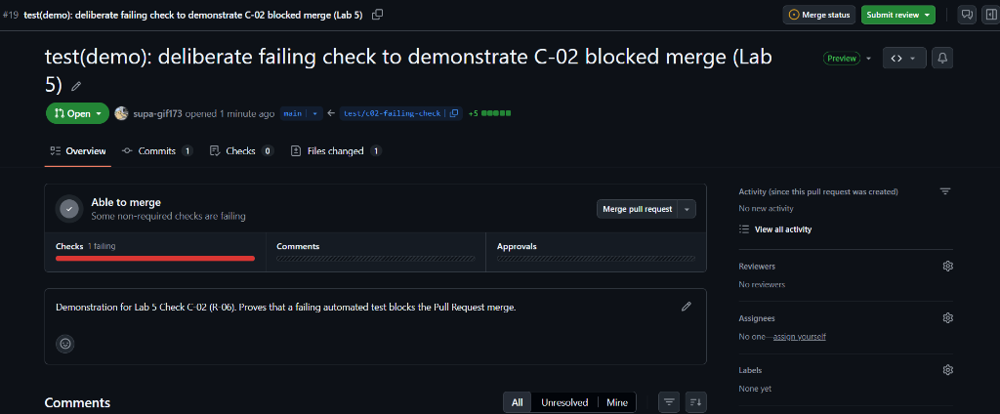

# Lab 5 Submission Report — CPE 334 Event Registration & Attendance System

## Answer Part 0 — Release Metadata & Evidence Index

### 0.1 Project & Team Identification
- **Course / Lab:** CPE 334 Software Engineering — Lab 5 (CI/CD, Containerization & Deployment Verification)
- **Team / Section:** ยอดนักบิด (`sec131`)
- **Members:**
  - Pimchaya Suprateravarnit (`@pimchayasupr-hash`)
  - Suphattra Kongsiriphat (`@supa-gif173`)
- **Submission PDF:** `lab5_sec131_ยอดนักบิด.pdf` *(Draft — awaiting GitHub Ruleset / C-02 redo in Issue #22 and PR merges)*
- **Repository:** `https://github.com/pimchayasupr-hash/cpe334-event-registration` (Visibility: `PUBLIC`, Secret Scanning: `enabled`, Push Protection: `enabled`)
- **Branching & Tag State:**
  - `main` latest commit (at verification time): `12d04b9` (`fix(docs): fix Part E contract file paths and embed full engineering contracts`)
  - Release PR #18 (`staging` -> `main`) merge commit: `10834da`
  - Git tag `v1.0.0-sprint1`: points to `2d36196` (one of 7 direct commits pushed to `main` after `10834da`; see Known Limitations)
  - Sync PR #24 (`main` -> `staging`): open, awaiting review/merge to align `staging` with `main`
- **Production Live URL:** ยังไม่ได้ทำ (No GCP Free Trial / billing account)
- **Running Commit on GCP:** ยังไม่ได้ทำ (No GCP deployment yet)

### 0.2 Pull Request, Review & Merge Audit

| PR Range / # | Branch Flow | Author | Reviewer / Approver | Merger | Notes |
| :--- | :--- | :--- | :--- | :--- | :--- |
| PR #2 – #14 | feature -> `staging` | `@pimchayasupr-hash` | `@supa-gif173` | `@pimchayasupr-hash` | Author and approver are distinct GitHub accounts |
| PR #16 – #17 | feature -> `staging` | `@supa-gif173` | `@pimchayasupr-hash` | `@supa-gif173` | Approved by `@pimchayasupr-hash`, merged by PR author (`@supa-gif173`) |
| PR #18 | `staging` -> `main` | `@supa-gif173` | `@pimchayasupr-hash` | `@pimchayasupr-hash` | Merge commit `10834da` |
| PR #19 | `test/c02-failing-check` -> `main` | `@supa-gif173` | None (0 reviews) | Closed unmerged | Opened `2026-11-12T12:35:49Z` before any ruleset existed; kept intact per R-10 |
| Direct pushes (`2d36196`..`12d04b9`) | direct to `main` | `@supa-gif173` | None (bypassed PR) | N/A (direct push) | 7 commits pushed directly to `main` while no branch protection / ruleset was active |
| PR #24 | `main` -> `staging` | `@pimchayasupr-hash` | Requested: `@supa-gif173` | Open | Syncs `10834da` and `2d36196`..`12d04b9` back into `staging`; CI `test-and-docker` run `43440605771` passed in 1m7s |

### 0.3 Evidence Index (Check C-01 – C-06)

| Check | Scope | Status | Verified Evidence |
| :--- | :--- | :--- | :--- |
| **C-01** | PR CI (`test-and-docker` on PR) | **Done** | PR #17, commit `aa0fd04`, GitHub Actions run `42981092219` (passed in 1m6s): 26/26 tests passed (Server 24, Client 2) + Docker build passed |
| **C-02** | Ruleset / Branch Protection blocks failing PR | **Pending (Issue #22)** | `gh api .../rulesets` currently returns `[]`. PR #19 (`screenshots/c02_failing_check.png`) shows `Able to merge` / `Some non-required checks are failing`. Kept PR #19 per R-10; will re-run C-02 after ruleset is configured |
| **C-03** | Clean-clone Docker build, migrate/seed & API probes | **Done** | Verified locally from clean clone of `main` (`12d04b9`): root `Dockerfile` built in 64.7s, `prisma migrate deploy` + `prisma:seed` succeeded, `/api/health` 200, `/api/ready` 200, `/api/events` 401 (unauthenticated), `/` 200 |
| **C-04** | Staging / Production Cloud Run deployment | **ยังไม่ได้ทำ** | No GCP Free Trial / billing account; `deploy-cloudrun.yml` run `43237080737` failed at `google-github-actions/auth` (`WIF_PROVIDER` / `credentials_json` not configured) |
| **C-05** | Production Cloud SQL + persistent data verification | **ยังไม่ได้ทำ** | Requires GCP Cloud Run + Cloud SQL |
| **C-06** | End-to-end pipeline & GCP revision matching commit | **ยังไม่ได้ทำ** | Requires GCP Cloud Run revision |

---

## Answer Part 1 — CI Pipeline & Branch Protection (C-01, C-02)

### C-01: Automated CI on Pull Request (`test-and-docker`)
- **Workflow:** `.github/workflows/ci.yml`
  - **Triggers:** `pull_request` targeting `main` and `staging`
  - **Job ID:** `test-and-docker`
- **Verified Run:** GitHub Actions Run `42981092219` on **PR #17** (commit `aa0fd04`, duration `1m6s`, approved by `@pimchayasupr-hash` on the same commit `aa0fd04`):
  - **Server (Vitest):** 4 test files, **24 tests passed** (0 failed, 0 skipped):
    - `events.test.ts`: 6 tests
    - `registrations.test.ts`: 6 tests
    - `auth.test.ts`: 7 tests
    - `roster-and-health.test.ts`: 5 tests
  - **Client (Vitest):** 1 test file, **2 tests passed** (0 failed, 0 skipped):
    - `src/App.test.tsx`: 2 tests
  - **Total:** **26 tests passed** (0 failed, 0 skipped), followed by Docker image build verification.
- **Additional Sync PR Check:** PR #24 (`main` -> `staging`, commit `12d04b9`) also passed `test-and-docker` in Run `43440605771` (`1m7s`).

### C-02: Branch Protection / Ruleset Enforcement (Pending — Issue #22)
- **Current Repository State:**
  - `gh api repos/pimchayasupr-hash/cpe334-event-registration/rulesets` returns `[]` (no active GitHub Ruleset or branch protection on `main` or `staging`).
- **Existing PR #19 Observation (`screenshots/c02_failing_check.png`):**
  - PR #19 (`test/c02-failing-check` -> `main`, opened `2026-11-12T12:35:49Z` by `@supa-gif173`, 0 reviews, closed unmerged) shows GitHub merge status **`Able to merge`** with **`Some non-required checks are failing`**.
  - This confirms that `test-and-docker` was not enforced as a required status check at that time, so C-02 is **not yet satisfied**.
- **Remediation Plan (R-10 Compliant):**
  - PR #19 and branch `test/c02-failing-check` are preserved untouched per rule R-10.
  - After configuring a GitHub Ruleset on `main` (requiring PR, at least 1 approval, and required status check `test-and-docker`), a new failing-check test PR will be opened to capture verified C-02 evidence (tracked in **Issue #22**).



---

## Answer Part 2 — Containerization & Deployment Runbook (C-03)

### C-03: Clean-Clone Docker Build, Migration, Seed & Runtime Probes
Executed from a fresh `git clone --branch main --single-branch` at commit `12d04b9` using an isolated Docker network (`c03-net`) with `postgres:16-alpine`:

1. **Docker Build (root `Dockerfile`):**
   - Multi-stage build (`client-builder`, `server-builder`, `production` on `node:24-alpine`, non-root `USER node`, port `3000`):
   - Result: `[+] Building 64.7s (25/25) FINISHED`, tagged `eventreg-c03:test`.
2. **Database Migration & Seed Inside Container:**
   - `npx prisma migrate deploy`: Applied `20261111000000_init` (`All migrations have been successfully applied.`).
   - `npm run prisma:seed`:
     ```text
     Seeding database...
     Seeded users: Organizer (organizer@kmutt.ac.th), Participant (participant@kmutt.ac.th)
     Seeded initial draft & published events.
     Seeding completed successfully.
     ```
3. **Runtime HTTP Probes (`http://127.0.0.1:3001` -> container port `3000`):**
   - `GET /api/health` -> `{"status":"ok"}` (`HTTP 200`)
   - `GET /api/ready` -> `{"status":"ready","database":"connected","db":"connected"}` (`HTTP 200`)
   - `GET /api/events` (unauthenticated) -> `{"error":"Authentication required"}` (`HTTP 401`)
   - `GET /` -> `HTTP 200` (SPA served by Express static middleware)

### Deployment Runbook
- Full local & template deployment instructions are maintained in [docs/labs/lab05/deployment.md](deployment.md).
- Note: Resource names using `toktickit` in `docs/labs/lab05/deployment.md` (such as `toktickit-pg` or `toktickit-app`) are **Starter Kit template example names**, not provisioned GCP resources.

---

## Answer Part 3 — Cloud Run & Cloud SQL Deployment (C-04, C-05)

- **Status:** **ยังไม่ได้ทำ (No GCP Free Trial / billing account)**
- **Observed Workflow Failure:** `.github/workflows/deploy-cloudrun.yml` (Run `43237080737`) failed at `google-github-actions/auth` because `WIF_PROVIDER` / `credentials_json` secrets are not configured in the repository.
- **C-04 (Cloud Run Deployment & Live Endpoints):** ยังไม่ได้ทำ
- **C-05 (Cloud SQL Persistence & Seed Verification):** ยังไม่ได้ทำ

---

## Answer Part 4 — End-to-End Pipeline & Revision Traceability (C-06)

- **Status:** **ยังไม่ได้ทำ (No GCP Free Trial / billing account)**
- **C-06 (Deployed GCP Revision matching Git Commit & Pipeline Run):** ยังไม่ได้ทำ (requires live Cloud Run revision from Part 3).

---

## Definition of Done (DoD)

- [x] Repository is `PUBLIC` with Secret Scanning and Push Protection enabled (R-12)
- [x] No secrets, private keys, or API tokens committed in Git history
- [x] C-01 verified via CI Run `42981092219` on PR #17 (`aa0fd04`, 26/26 tests passed)
- [x] C-03 verified via clean-clone Docker build, `prisma migrate deploy`, `prisma:seed`, and HTTP probes (`12d04b9`)
- [x] Submission directory standardized to `docs/labs/lab05/`
- [ ] GitHub Ruleset configured on `main` & `staging`, and C-02 re-verified with failing PR (Issue #22)
- [ ] Part 3 (C-04, C-05) & Part 4 (C-06) deployed and verified on GCP Cloud Run + Cloud SQL
- [ ] Open Lab 5 PRs (#24, #20, #21, #22, #23) reviewed and merged by teammates
- [ ] Final `lab5_sec131_ยอดนักบิด.pdf` regenerated after all checks and merges

---

## Known Limitations

1. **No GCP Account / Billing:** Part 3 (C-04, C-05) and Part 4 (C-06) have not been executed because no GCP Free Trial / billing account is available yet. The `toktickit` names in `docs/labs/lab05/deployment.md` are Starter Kit template defaults, not live GCP resources.
2. **Missing GitHub Ruleset (C-02 Pending):** No GitHub Ruleset is currently active (`rulesets` = `[]`). PR #19 was opened prior to ruleset setup and shows `Able to merge` despite failing checks; it is preserved per R-10, and C-02 will be re-run in Issue #22 after configuring the ruleset.
3. **Direct Pushes & Tag Alignment:** 7 commits (`2d36196`..`12d04b9`) by `@supa-gif173` were pushed directly to `main` without a PR/review, and `v1.0.0-sprint1` points to `2d36196` rather than Release PR #18 (`10834da`). Additionally, PRs #16 and #17 were merged by their author (`@supa-gif173`) after receiving approval from `@pimchayasupr-hash`.
4. **Demo Credential & Seed Env Mismatch (Tracked in Issue #21):** `deploy/deploy.sh` passes `ADMIN_PASSWORD` / `DEMO_USER_PASSWORD`, whereas `server/prisma/seed.ts` reads `SEED_ORGANIZER_PASSWORD` / `SEED_PARTICIPANT_PASSWORD`, and `client/src/App.tsx` embeds demo login defaults (`AdminInitial123!` / `Participant123!`). Disclosed as a known limitation for documentation only.
