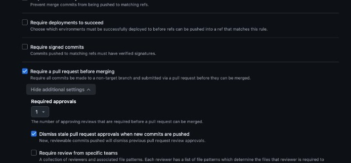
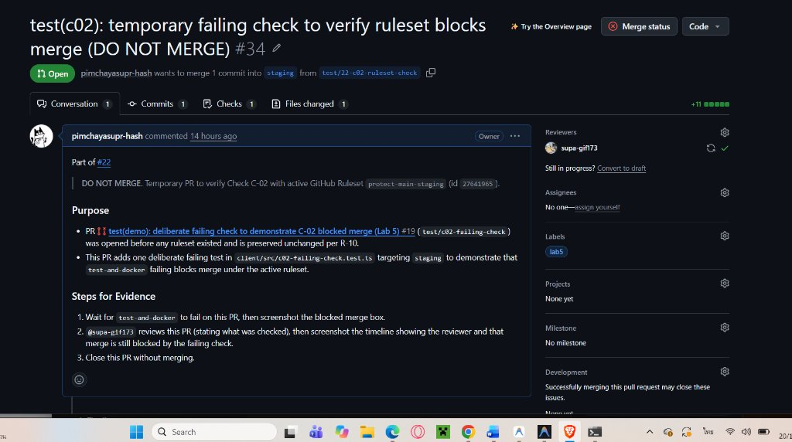
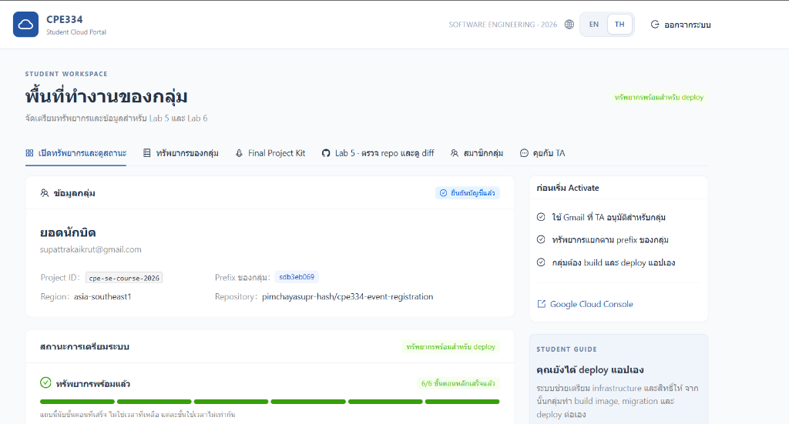
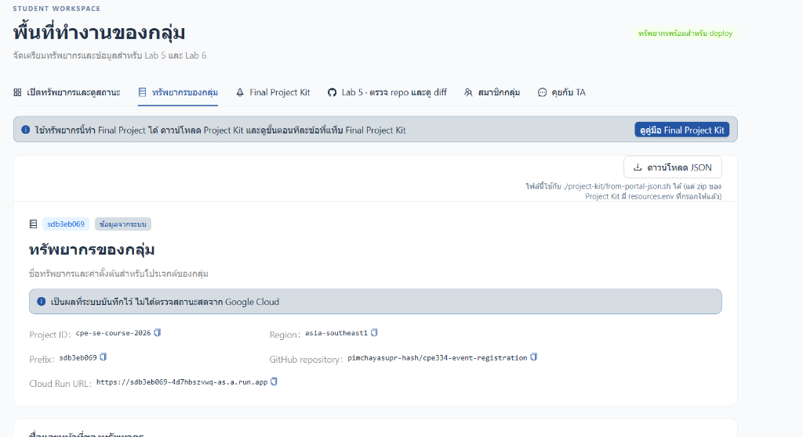
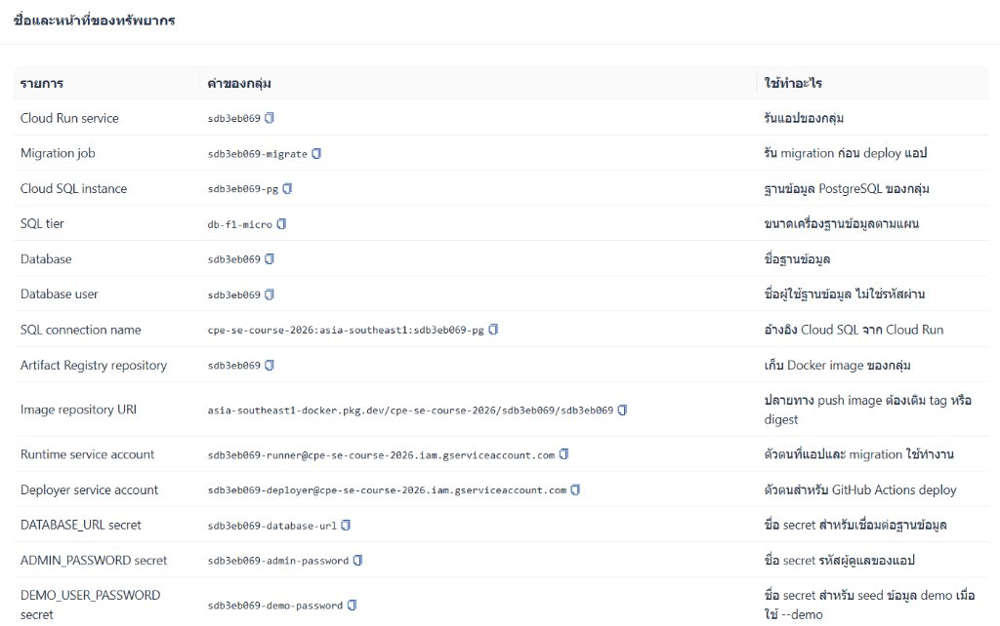
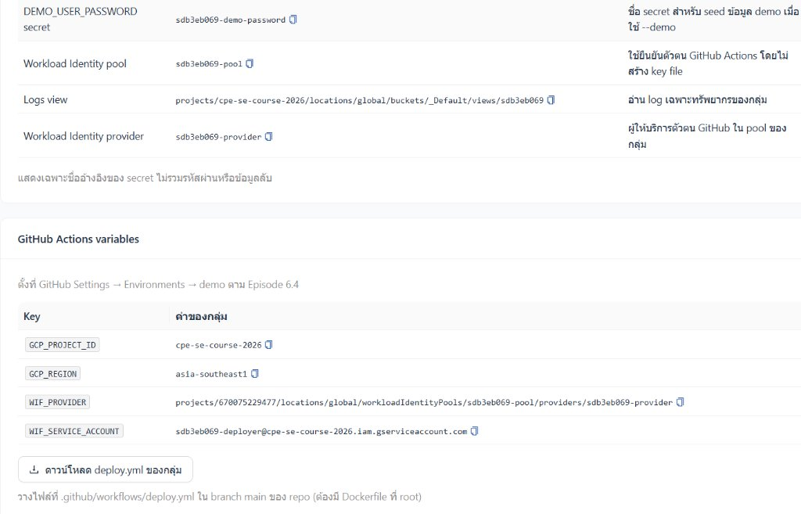

# Lab 5 Submission Report — CPE 334 Event Registration & Attendance System

## Answer Part 0 — Team, Release Metadata & Evidence Index

### 0.1 Project & Team Identification
- **Course / Lab:** CPE 334 Software Engineering — Lab 5 (CI/CD, Containerization & Deployment Verification)
- **Team / Section:** ยอดนักบิด (`sec131`)
- **Members:**
  - Pimchaya Suprateravarnit — Student ID: `67070505223` — GitHub: `@pimchayasupr-hash`
  - Suphattra Kongsiriphat — Student ID: `67070505228` — GitHub: `@supa-gif173`
- **Submission Document:** `lab5_sec131_ยอดนักบิด.docx` / `lab5_sec131_ยอดนักบิด.pdf`
- **Repository:** https://github.com/pimchayasupr-hash/cpe334-event-registration (Visibility: `PUBLIC`, Secret Scanning: `enabled`, Push Protection: `enabled`)
- **Production Live URL:** https://sdb3eb069-4d7hbszvwq-as.a.run.app (Activated via CPE334 Student Cloud Portal on 19 พ.ย. 2569; รอ Deploy demo สำเร็จหลัง merge PR #39)
- **Running Commit on GCP:** ยังไม่เริ่มทำงานจริง (Deploy demo run 44986537160 บน commit 8f082c9 ล้มเหลวที่ migration job; รอ Deploy demo รอบใหม่หลัง PR #39)

**Version Table (Sprint 1 Baseline & Lab 5 Staging):**

| Role | Commit | Evidence |
| :--- | :--- | :--- |
| Release PR #18 head tested by CI | `e2846b8` (`staging`) | CI run [43210196284](https://github.com/pimchayasupr-hash/cpe334-event-registration/actions/runs/43210196284) (`pull_request`, success) |
| Release PR #18 merge commit on `main` | `10834da` | [PR #18](https://github.com/pimchayasupr-hash/cpe334-event-registration/pull/18) merged by `@pimchayasupr-hash` |
| Tag `v1.0.0-sprint1` | `2d36196` | `git diff --stat 10834da 2d36196` → only `docs/deliverable-1-report.md` (270 insertions); app code identical to `10834da` |
| `main` head at verification time | `8f082c9` | Release PR #38 merge commit on `main` deployed to Cloud Run |
| `staging` head (Lab 5 doc merges) | `75498e9` | [PR #37](https://github.com/pimchayasupr-hash/cpe334-event-registration/pull/37) merged after PR #36 and PR #32 |

### 0.2 Team Contribution Table (Verified GitHub Issues & PRs)

| Member | Authored PRs / Issues | Reviewed / Approved | Merged |
| :--- | :--- | :--- | :--- |
| **Pimchaya Suprateravarnit** (`@pimchayasupr-hash`) | PRs [#2–#14](https://github.com/pimchayasupr-hash/cpe334-event-registration/pulls?q=is%3Apr+author%3Apimchayasupr-hash), [#24](https://github.com/pimchayasupr-hash/cpe334-event-registration/pull/24), [#25](https://github.com/pimchayasupr-hash/cpe334-event-registration/pull/25), [#26](https://github.com/pimchayasupr-hash/cpe334-event-registration/pull/26), [#32](https://github.com/pimchayasupr-hash/cpe334-event-registration/pull/32), [#33](https://github.com/pimchayasupr-hash/cpe334-event-registration/pull/33), [#34](https://github.com/pimchayasupr-hash/cpe334-event-registration/pull/34), [#36](https://github.com/pimchayasupr-hash/cpe334-event-registration/pull/36), [#37](https://github.com/pimchayasupr-hash/cpe334-event-registration/pull/37), [#38](https://github.com/pimchayasupr-hash/cpe334-event-registration/pull/38); Issues [#20](https://github.com/pimchayasupr-hash/cpe334-event-registration/issues/20), [#21](https://github.com/pimchayasupr-hash/cpe334-event-registration/issues/21), [#22](https://github.com/pimchayasupr-hash/cpe334-event-registration/issues/22), [#23](https://github.com/pimchayasupr-hash/cpe334-event-registration/issues/23), [#27](https://github.com/pimchayasupr-hash/cpe334-event-registration/issues/27), [#28](https://github.com/pimchayasupr-hash/cpe334-event-registration/issues/28), [#29](https://github.com/pimchayasupr-hash/cpe334-event-registration/issues/29), [#30](https://github.com/pimchayasupr-hash/cpe334-event-registration/issues/30), [#31](https://github.com/pimchayasupr-hash/cpe334-event-registration/issues/31) (pair `R-11`), [#35](https://github.com/pimchayasupr-hash/cpe334-event-registration/issues/35) | Approved [PR #16](https://github.com/pimchayasupr-hash/cpe334-event-registration/pull/16), [PR #17](https://github.com/pimchayasupr-hash/cpe334-event-registration/pull/17), [PR #18](https://github.com/pimchayasupr-hash/cpe334-event-registration/pull/18) | PRs #2–#14, [#18](https://github.com/pimchayasupr-hash/cpe334-event-registration/pull/18), [#25](https://github.com/pimchayasupr-hash/cpe334-event-registration/pull/25), [#38](https://github.com/pimchayasupr-hash/cpe334-event-registration/pull/38) |
| **Suphattra Kongsiriphat** (`@supa-gif173`) | PRs [#16](https://github.com/pimchayasupr-hash/cpe334-event-registration/pull/16), [#17](https://github.com/pimchayasupr-hash/cpe334-event-registration/pull/17), [#18](https://github.com/pimchayasupr-hash/cpe334-event-registration/pull/18), [#19](https://github.com/pimchayasupr-hash/cpe334-event-registration/pull/19); 7 direct commits (`2d36196..12d04b9`) on `main`; co-named on Issues [#20](https://github.com/pimchayasupr-hash/cpe334-event-registration/issues/20)–[#23](https://github.com/pimchayasupr-hash/cpe334-event-registration/issues/23), [#27](https://github.com/pimchayasupr-hash/cpe334-event-registration/issues/27)–[#31](https://github.com/pimchayasupr-hash/cpe334-event-registration/issues/31) (`R-11`) | Approved PRs #2–#14, [#24](https://github.com/pimchayasupr-hash/cpe334-event-registration/pull/24)*, [#25](https://github.com/pimchayasupr-hash/cpe334-event-registration/pull/25), [#26](https://github.com/pimchayasupr-hash/cpe334-event-registration/pull/26), [#32](https://github.com/pimchayasupr-hash/cpe334-event-registration/pull/32), [#34](https://github.com/pimchayasupr-hash/cpe334-event-registration/pull/34), [#36](https://github.com/pimchayasupr-hash/cpe334-event-registration/pull/36), [#37](https://github.com/pimchayasupr-hash/cpe334-event-registration/pull/37) | PRs [#16](https://github.com/pimchayasupr-hash/cpe334-event-registration/pull/16), [#17](https://github.com/pimchayasupr-hash/cpe334-event-registration/pull/17), [#24](https://github.com/pimchayasupr-hash/cpe334-event-registration/pull/24), [#26](https://github.com/pimchayasupr-hash/cpe334-event-registration/pull/26), [#32](https://github.com/pimchayasupr-hash/cpe334-event-registration/pull/32), [#36](https://github.com/pimchayasupr-hash/cpe334-event-registration/pull/36), [#37](https://github.com/pimchayasupr-hash/cpe334-event-registration/pull/37) |

*(Note: PR #24 approval by `@supa-gif173` is a sync of their own 7 direct-push commits, not an independent review — disclosed in Table 0.3 & Known Limitations.)*

### 0.3 Pull Request, Review & Merge Audit

| PR / Ref | Flow | Author | Reviewer / Approver | Merger & Status |
| :--- | :--- | :--- | :--- | :--- |
| PR #2 – #14 | feature -> `staging` | `@pimchayasupr-hash` | `@supa-gif173` | `@pimchayasupr-hash` (`MERGED`) |
| [PR #16](https://github.com/pimchayasupr-hash/cpe334-event-registration/pull/16) – [PR #17](https://github.com/pimchayasupr-hash/cpe334-event-registration/pull/17) | feature -> `staging` | `@supa-gif173` | `@pimchayasupr-hash` | `@supa-gif173` (`MERGED`, self-merged after approval) |
| [PR #18](https://github.com/pimchayasupr-hash/cpe334-event-registration/pull/18) | `staging` -> `main` | `@supa-gif173` | `@pimchayasupr-hash` | `@pimchayasupr-hash` (`MERGED`, `10834da`) |
| [PR #19](https://github.com/pimchayasupr-hash/cpe334-event-registration/pull/19) | `test/c02-failing-check` -> `main` | `@supa-gif173` | None (0 reviews) | `CLOSED` unmerged (pre-ruleset, kept per R-10) |
| Direct (`2d36196..12d04b9`) | direct to `main` | `@supa-gif173` | None (bypassed PR) | 7 direct pushes before ruleset |
| [PR #24](https://github.com/pimchayasupr-hash/cpe334-event-registration/pull/24) | `main` -> `staging` | `@pimchayasupr-hash` | `@supa-gif173` (`12d04b9`, sync only) | `@supa-gif173` (`MERGED`, `2026-11-20T03:45:56Z`) |
| [PR #26](https://github.com/pimchayasupr-hash/cpe334-event-registration/pull/26) | `lab5/21` -> `lab5/20` | `@pimchayasupr-hash` | `@supa-gif173` (`08186ae`) | `@supa-gif173` (`MERGED`, `2026-11-20T03:43:26Z`) |
| [PR #25](https://github.com/pimchayasupr-hash/cpe334-event-registration/pull/25) | `lab5/20` -> `staging` | `@pimchayasupr-hash` | `@supa-gif173` (`32e546e`) | `@pimchayasupr-hash` (`MERGED`, `2026-11-20T05:11:41Z`) |
| [PR #34](https://github.com/pimchayasupr-hash/cpe334-event-registration/pull/34) | `test/22-c02` -> `staging` | `@pimchayasupr-hash` | `@supa-gif173` (`4d68bfb`, edited `04:10:48Z`) | `CLOSED` unmerged (C-02 blocked-merge proof) |
| [PR #36](https://github.com/pimchayasupr-hash/cpe334-event-registration/pull/36) | `lab5/35` -> `staging` | `@pimchayasupr-hash` | `@supa-gif173` (`7f3d8a2`) | `@supa-gif173` (`MERGED`, `2e4cb11`) |
| [PR #32](https://github.com/pimchayasupr-hash/cpe334-event-registration/pull/32) | `lab5/27` -> `staging` | `@pimchayasupr-hash` | `@supa-gif173` (`bb94d99`) | `@supa-gif173` (`MERGED`, `47bde54`) |
| [PR #37](https://github.com/pimchayasupr-hash/cpe334-event-registration/pull/37) | `lab5/shared-cloud` -> `staging` | `@pimchayasupr-hash` | `@supa-gif173` (`1dd1a43`) | `@supa-gif173` (`MERGED`, `75498e9`) |
| [PR #38](https://github.com/pimchayasupr-hash/cpe334-event-registration/pull/38) | `staging` -> `main` | `@supa-gif173` | `@pimchayasupr-hash` (`75498e9`) | `@pimchayasupr-hash` (`MERGED`, `8f082c9`) |
| [PR #39](https://github.com/pimchayasupr-hash/cpe334-event-registration/pull/39) | `lab5/fix-migration-secrets` -> `staging` | `@supa-gif173` | Pending (`@pimchayasupr-hash`) | `OPEN` (fix migration secrets & smoke test) |
| [PR #33](https://github.com/pimchayasupr-hash/cpe334-event-registration/pull/33) | `lab6/28` -> `staging` | `@pimchayasupr-hash` | None yet | `OPEN (DRAFT)` (Lab 6 UAT plan/templates) |

### 0.4 Evidence Index (Check C-01 – C-06)

| Check | Scope | Status | Verified Evidence |
| :--- | :--- | :--- | :--- |
| **C-01** | PR CI (`test-and-docker`) | **Done** | [PR #17](https://github.com/pimchayasupr-hash/cpe334-event-registration/pull/17) (`aa0fd04`), GitHub Actions run [42981092219](https://github.com/pimchayasupr-hash/cpe334-event-registration/actions/runs/42981092219) (1m6s): 26/26 tests passed (Server 24, Client 2) + Docker build passed |
| **C-02** | Ruleset blocks failing PR | **Done** | Ruleset [protect-main-staging](https://github.com/pimchayasupr-hash/cpe334-event-registration/rules/27641965) (ID `27641965`, `active`) + [PR #34](https://github.com/pimchayasupr-hash/cpe334-event-registration/pull/34) (`4d68bfb`, run [44535404522](https://github.com/pimchayasupr-hash/cpe334-event-registration/actions/runs/44535404522) failed 44s): merge blocked even after approval, closed unmerged |
| **C-03** | Clean-clone Docker build & probes | **Done** | Verified on `main` at `8f082c9` with `seed-config.ts` fallback: Docker build passed, migrate+seed applied, `/api/health` 200, `/api/ready` 200, `/api/events` 401 (auth enforced), `/` 200 |
| **C-04** | Cloud Run deployment & live URL | **รอผล Deploy** | ทรัพยากรบน `cpe-se-course-2026` พร้อม; รอรัน Deploy demo รอบใหม่หลัง merge PR #39 ก่อนทดสอบบน Live URL https://sdb3eb069-4d7hbszvwq-as.a.run.app |
| **C-05** | Cloud SQL persistence | **รอผล Deploy** | เชื่อมต่อ Cloud SQL PostgreSQL `sdb3eb069-pg`; รอเก็บภาพ persistence หลัง deploy ผ่าน |
| **C-06** | End-to-end pipeline & GCP revision | **รอผล Deploy** | Release PR #38 เข้า main แล้ว; รอ commit SHA ของ release ถัดไปหลัง PR #39 เข้า main |

---

## Answer Part 1 — CI Pipeline & Branch Protection (C-01, C-02)

### C-01: Automated CI on Pull Request (`test-and-docker`)
- **Workflow:** [.github/workflows/ci-docker.yml](https://github.com/pimchayasupr-hash/cpe334-event-registration/blob/main/.github/workflows/ci-docker.yml) (`pull_request` on `main` and `staging`, job ID `test-and-docker`).
- **Verified Run:** Run [42981092219](https://github.com/pimchayasupr-hash/cpe334-event-registration/actions/runs/42981092219) on [PR #17](https://github.com/pimchayasupr-hash/cpe334-event-registration/pull/17) (commit `aa0fd04`, `1m6s`, approved by `@pimchayasupr-hash` on `aa0fd04`):
  - **Server (Vitest):** 4 files, **24 tests passed** (`events.test.ts`: 6, `registrations.test.ts`: 6, `auth.test.ts`: 7, `roster-and-health.test.ts`: 5)
  - **Client (Vitest):** 1 file, **2 tests passed** (`src/App.test.tsx`: 2)
  - **Total:** **26 tests passed** (0 failed, 0 skipped), plus production Docker build verification.
- **Additional Sync Check:** [PR #24](https://github.com/pimchayasupr-hash/cpe334-event-registration/pull/24) passed `test-and-docker` on run [43440605771](https://github.com/pimchayasupr-hash/cpe334-event-registration/actions/runs/43440605771) (`1m7s`).

### C-02: Ruleset Enforcement & Blocked Merge (PR #34)
- **Active Ruleset:** [protect-main-staging](https://github.com/pimchayasupr-hash/cpe334-event-registration/rules/27641965) (ID `27641965`, `enforcement: active`) targeting `refs/heads/main` and `refs/heads/staging`, `bypass_actors: []`:
```json
[
  { "type": "deletion" },
  { "type": "non_fast_forward" },
  { "type": "pull_request", "parameters": { "required_approving_review_count": 1, "dismiss_stale_reviews_on_push": true } },
  { "type": "required_status_checks", "parameters": { "required_status_checks": [{ "context": "test-and-docker", "integration_id": 15368 }] } }
]
```
- **Blocked Merge Proof:** [PR #34](https://github.com/pimchayasupr-hash/cpe334-event-registration/pull/34) (`test/22-c02-ruleset-check` -> `staging`, commit `4d68bfb`) failed `test-and-docker` in 44s (run [44535404522](https://github.com/pimchayasupr-hash/cpe334-event-registration/actions/runs/44535404522)). `@supa-gif173` submitted approval at `2026-11-20T02:48:24Z`; รีวิวถูกแก้ภายหลังโดย `supa-gif173` (`2026-11-20T04:10:48Z`). Even with approval, GitHub disabled `Merge pull request`, and PR #34 was closed unmerged.
- **Pre-Ruleset Baseline:** [PR #19](https://github.com/pimchayasupr-hash/cpe334-event-registration/pull/19) (`test/c02-failing-check`, `2026-11-12T12:35:49Z`) was opened before any ruleset existed and showed `Able to merge`; it is kept intact per R-10 and not used as blocking evidence.








---

## Answer Part 2 — Containerization & Deployment Runbook (C-03)

### Configuration & Build Artifacts
- [Dockerfile](https://github.com/pimchayasupr-hash/cpe334-event-registration/blob/main/Dockerfile) | [.dockerignore](https://github.com/pimchayasupr-hash/cpe334-event-registration/blob/main/.dockerignore) | [.env.example](https://github.com/pimchayasupr-hash/cpe334-event-registration/blob/main/.env.example) | [docs/labs/lab05/deployment.md](https://github.com/pimchayasupr-hash/cpe334-event-registration/blob/main/docs/labs/lab05/deployment.md)
- Resource names configured for group prefix `sdb3eb069` on central project `cpe-se-course-2026` in `asia-southeast1`.

### C-03: Clean-Clone Verification
Executed from clean clone using isolated Docker network `c03-net` (`postgres:16-alpine`) and `.env.example` variable names (`DATABASE_URL`, `SEED_ORGANIZER_EMAIL`, `SEED_ORGANIZER_PASSWORD`, `SEED_PARTICIPANT_EMAIL`, `SEED_PARTICIPANT_PASSWORD`):
- **Docker build:** `[+] Building (25/25) FINISHED` (`eventreg-c03:test`)
- **Migrate & Seed:** `npx prisma migrate deploy` applied `20261111000000_init`; `npm run prisma:seed` seeded Organizer, Participant, and initial events using non-destructive `upsert` logic.
- **HTTP Probes (`http://127.0.0.1:3001` -> container port `3000`):**
  - `GET /api/health` -> `{"status":"ok"}` (`HTTP 200`)
  - `GET /api/ready` -> `{"status":"ready","database":"connected","db":"connected"}` (`HTTP 200`)
  - `GET /api/events` (unauthenticated) -> `{"error":"Authentication required"}` (`HTTP 401`)
  - `GET /` -> `HTTP 200`

---

## Answer Part 3 — Cloud Run & Cloud SQL Deployment (C-04, C-05)

### C-04: Live Deployment Verification
- **Course Portal Activation:** Activated on 19 พ.ย. 2569 via CPE334 Student Cloud Portal.
- **Assigned Prefix:** `sdb3eb069`
- **GCP Project:** `cpe-se-course-2026` (Region: `asia-southeast1`)
- **Public Service URL:** https://sdb3eb069-4d7hbszvwq-as.a.run.app
- **Cloud Run Service:** `sdb3eb069`
- **Migration Job:** `sdb3eb069-migrate` (Runs `npx prisma migrate deploy && npm run prisma:seed` with Secret Manager secrets `sdb3eb069-database-url`, `sdb3eb069-admin-password`, `sdb3eb069-demo-password`)
- **Cloud SQL Instance:** `sdb3eb069-pg` (`cpe-se-course-2026:asia-southeast1:sdb3eb069-pg`)
- **Runtime Identity:** `sdb3eb069-runner@cpe-se-course-2026.iam.gserviceaccount.com`
- **Deployer Identity:** `sdb3eb069-deployer@cpe-se-course-2026.iam.gserviceaccount.com`
- **Workload Identity Provider:** `projects/670075229477/locations/global/workloadIdentityPools/sdb3eb069-pool/providers/sdb3eb069-provider`
- **Deployment Status:** Run `44986537160` บน commit `8f082c9` พบข้อผิดพลาดที่ `sdb3eb069-migrate` เนื่องจาก secret ยังไม่ได้ผูก; แก้ไขแล้วใน PR #39 (`lab5/fix-migration-secrets`). รอรัน Deploy demo รอบใหม่หลัง merge PR #39 เข้า main ก่อนเปิดทดสอบหน้าเว็บจริงและบันทึกภาพ C-04









### C-05: Cloud SQL Data Persistence
- Data persistence is configured via managed Cloud SQL PostgreSQL instance `sdb3eb069-pg`.
- การทดสอบ Persistence (สร้างข้อมูล -> restart/redeploy -> ตรวจสอบข้อมูล) จะดำเนินการหลัง Deploy demo รอบใหม่สำเร็จ

---

## Answer Part 4 — End-to-End Pipeline & Revision Traceability (C-06)

### C-06: Traceability Matrix (Release PR, Pipeline Run, Revision SHA)
- **Release Pull Request:** [PR #38](https://github.com/pimchayasupr-hash/cpe334-event-registration/pull/38) (`staging` -> `main`, opened by `@supa-gif173`, approved and merged by `@pimchayasupr-hash` at commit `8f082c9`).
- **Pipeline Run Status:** Run `44986537160` บน commit `8f082c9` failed at migration step. PR #39 (`lab5/fix-migration-secrets`) แก้ไขการผูก secret และ smoke test.
- **Traceability Verification:** ตรวจสอบย้อนกลับฉบับสมบูรณ์จะเชื่อมโยงกับ commit SHA ใหม่หลัง merge PR #39 เข้า main และ Deploy demo สำเร็จ

---

## Definition of Done (DoD)

- [x] Repository is `PUBLIC` with Secret Scanning and Push Protection enabled (R-12)
- [x] No secrets, private keys, or API token prefixes found on `origin/main` or `origin/staging` by the following checks:
  - `git ls-tree -r --full-tree --name-only origin/main | grep -E '.env$|.pem$|.key$|credentials|service-account|service_account|serviceaccount'` (0 matches; same on `origin/staging`)
  - `git log --all -G"(AIza|ghp_|github_pat_|ya29.|AKIA|BEGIN PRIVATE KEY)" --oneline` (0 matches)
- [x] C-01 verified via CI Run [42981092219](https://github.com/pimchayasupr-hash/cpe334-event-registration/actions/runs/42981092219) on [PR #17](https://github.com/pimchayasupr-hash/cpe334-event-registration/pull/17) (`aa0fd04`, 26/26 tests passed)
- [x] C-02 verified via Ruleset [27641965](https://github.com/pimchayasupr-hash/cpe334-event-registration/rules/27641965) + [PR #34](https://github.com/pimchayasupr-hash/cpe334-event-registration/pull/34) (`4d68bfb`, run [44535404522](https://github.com/pimchayasupr-hash/cpe334-event-registration/actions/runs/44535404522) failed, merge blocked)
- [x] C-03 verified on clean clone with `.env.example` variable resolution
- [ ] Part 3 (C-04, C-05) & Part 4 (C-06) deployed and verified via course Google Cloud system (รอ Deploy demo ผ่านหลัง merge PR #39)
- [ ] PR #39 merged into `staging` and Release PR merged into `main`
- [ ] Final academic submission document generated (ฉบับสมบูรณ์พร้อมหลักฐาน C-04/C-05/C-06 หลัง Deploy ผ่าน)

---

## Known Limitations

1. **Direct Pushes & Tag Alignment:** 7 commits (`2d36196..12d04b9`) by `@supa-gif173` were pushed directly to `main` before ruleset setup; tag `v1.0.0-sprint1` points to `2d36196` rather than [PR #18](https://github.com/pimchayasupr-hash/cpe334-event-registration/pull/18) (`10834da`). PRs [#16](https://github.com/pimchayasupr-hash/cpe334-event-registration/pull/16) and [#17](https://github.com/pimchayasupr-hash/cpe334-event-registration/pull/17) were self-merged by `@supa-gif173` after approval.
2. **Sync PR #24 Not an Independent Review:** Opened by `@pimchayasupr-hash`, approved/merged by `@supa-gif173` who authored all 7 synced commits.
3. **Demo Credentials Dual-Alias Compatibility:** Resolved in PR #32 via `seed-config.ts` supporting both `SEED_ORGANIZER_PASSWORD` / `ADMIN_PASSWORD` and `SEED_PARTICIPANT_PASSWORD` / `DEMO_USER_PASSWORD`.
4. **Initial Deploy demo Failure on 8f082c9:** Deploy demo run 44986537160 on commit 8f082c9 failed at migration job execution due to missing secret binding on `sdb3eb069-migrate`. Fixed in PR #39 by updating `deploy/release.sh` to pass `--update-secrets` and updating `deploy/smoke_test.py` for 401 auth routes.
