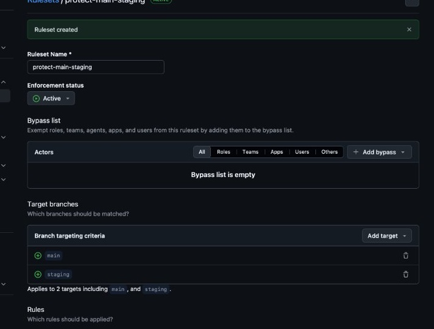
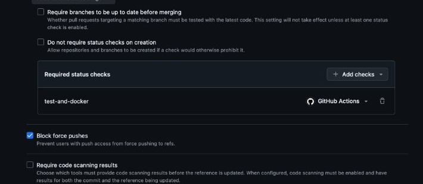
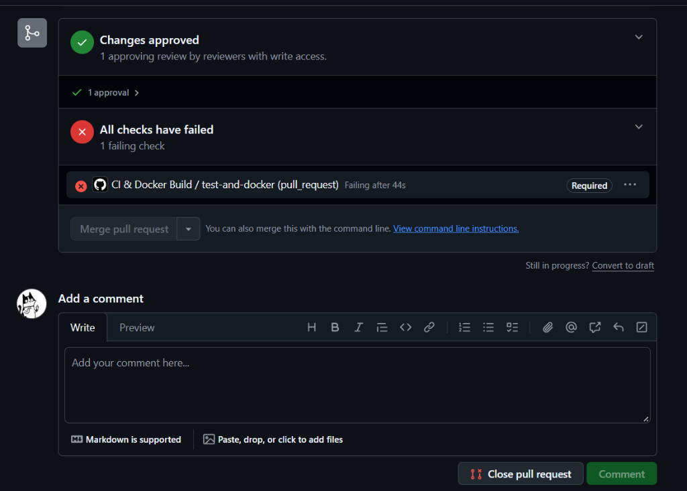
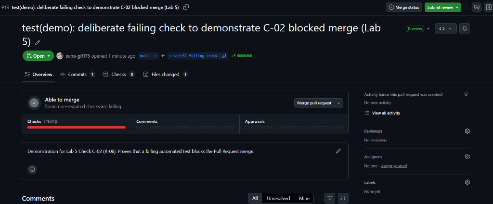

# Lab 5 Submission Report — CPE 334 Event Registration & Attendance System

## Answer Part 0 — Team, Release Metadata & Evidence Index

### 0.1 Project & Team Identification
- **Course / Lab:** CPE 334 Software Engineering — Lab 5 (CI/CD, Containerization & Deployment Verification)
- **Team / Section:** ยอดนักบิด (`sec131`)
- **Members:**
  - Pimchaya Suprateravarnit — Student ID: `[รอผู้ใช้กรอก]` — GitHub: `@pimchayasupr-hash`
  - Suphattra Kongsiriphat — Student ID: `[รอผู้ใช้กรอก]` — GitHub: `@supa-gif173`
- **Submission PDF:** `lab5_sec131_ยอดนักบิด.pdf` *(C-01, C-02, C-03 verified; Part 3–4 ยังไม่ได้ทำ — รอ Activate ระบบ Google Cloud ของรายวิชา)*
- **Repository:** [pimchayasupr-hash/cpe334-event-registration](https://github.com/pimchayasupr-hash/cpe334-event-registration) (Visibility: `PUBLIC`, Secret Scanning: `enabled`, Push Protection: `enabled`)
- **Production Live URL:** ยังไม่ได้ทำ (อยู่ระหว่างขอ Activate ระบบ Google Cloud ของรายวิชา; `[วันที่ติดต่อ TA / ประกาศ: รอผู้ใช้กรอก]`)
- **Running Commit on GCP:** ยังไม่ได้ทำ (No GCP deployment yet)

**Version Table (Sprint 1 Baseline & Lab 5 Staging):**

| Role | Commit | Evidence |
| :--- | :--- | :--- |
| Release PR #18 head tested by CI | `e2846b8` (`staging`) | CI run `43210196284` (`pull_request`, success) |
| Release PR #18 merge commit on `main` | `10834da` | [PR #18](https://github.com/pimchayasupr-hash/cpe334-event-registration/pull/18) merged by `@pimchayasupr-hash` |
| Tag `v1.0.0-sprint1` | `2d36196` | `git diff --stat 10834da 2d36196` → only `docs/deliverable-1-report.md` (270 insertions); app code identical to `10834da` |
| `main` head at verification time | `12d04b9` | `10834da..12d04b9` changes `docs/`, report `scripts/`, and root `package*.json` only; no files under `server/` or `client/` |
| `staging` head (Lab 5 doc merges) | `edfc143` | `edfc143858fab754a59866b916eac081309fc3ac` after PR #24, #26, #25 merged |

### 0.2 Team Contribution Table (Verified GitHub Issues & PRs)

| Member | Authored PRs / Issues | Reviewed / Approved | Merged |
| :--- | :--- | :--- | :--- |
| **Pimchaya Suprateravarnit** (`@pimchayasupr-hash`) | Opened PRs [#2–#14](https://github.com/pimchayasupr-hash/cpe334-event-registration/pulls?q=is%3Apr+author%3Apimchayasupr-hash), [#24](https://github.com/pimchayasupr-hash/cpe334-event-registration/pull/24), [#25](https://github.com/pimchayasupr-hash/cpe334-event-registration/pull/25), [#26](https://github.com/pimchayasupr-hash/cpe334-event-registration/pull/26), [#32](https://github.com/pimchayasupr-hash/cpe334-event-registration/pull/32), [#33](https://github.com/pimchayasupr-hash/cpe334-event-registration/pull/33), [#34](https://github.com/pimchayasupr-hash/cpe334-event-registration/pull/34), [#36](https://github.com/pimchayasupr-hash/cpe334-event-registration/pull/36); Issues [#20](https://github.com/pimchayasupr-hash/cpe334-event-registration/issues/20)–[#23](https://github.com/pimchayasupr-hash/cpe334-event-registration/issues/23), [#27](https://github.com/pimchayasupr-hash/cpe334-event-registration/issues/27)–[#31](https://github.com/pimchayasupr-hash/cpe334-event-registration/issues/31), [#35](https://github.com/pimchayasupr-hash/cpe334-event-registration/issues/35) (pair work `R-11`) | Approved PRs #16, #17, [#18](https://github.com/pimchayasupr-hash/cpe334-event-registration/pull/18) | Merged PRs #2–#14, [#18](https://github.com/pimchayasupr-hash/cpe334-event-registration/pull/18), [#25](https://github.com/pimchayasupr-hash/cpe334-event-registration/pull/25) |
| **Suphattra Kongsiriphat** (`@supa-gif173`) | Opened PRs #16, #17, [#18](https://github.com/pimchayasupr-hash/cpe334-event-registration/pull/18), [#19](https://github.com/pimchayasupr-hash/cpe334-event-registration/pull/19); 7 direct commits (`2d36196..12d04b9`) on `main`; co-owner on Issues #20–#23, #27–#31, #35 (`R-11`) | Approved PRs #2–#14, [#24](https://github.com/pimchayasupr-hash/cpe334-event-registration/pull/24)*, [#25](https://github.com/pimchayasupr-hash/cpe334-event-registration/pull/25), [#26](https://github.com/pimchayasupr-hash/cpe334-event-registration/pull/26), [#32](https://github.com/pimchayasupr-hash/cpe334-event-registration/pull/32), [#34](https://github.com/pimchayasupr-hash/cpe334-event-registration/pull/34) | Merged PRs #16, #17, [#24](https://github.com/pimchayasupr-hash/cpe334-event-registration/pull/24), [#26](https://github.com/pimchayasupr-hash/cpe334-event-registration/pull/26) |

*(Note: PR #24 approval by `@supa-gif173` is a sync of her own 7 direct-push commits, not an independent review — disclosed in Table 0.3 & Known Limitations.)*

### 0.3 Pull Request, Review & Merge Audit

| PR / Ref | Flow | Author | Reviewer / Approver | Merger & Status |
| :--- | :--- | :--- | :--- | :--- |
| PR #2 – #14 | feature -> `staging` | `@pimchayasupr-hash` | `@supa-gif173` | `@pimchayasupr-hash` (`MERGED`) |
| PR #16 – #17 | feature -> `staging` | `@supa-gif173` | `@pimchayasupr-hash` | `@supa-gif173` (`MERGED`, self-merged after approval) |
| [PR #18](https://github.com/pimchayasupr-hash/cpe334-event-registration/pull/18) | `staging` -> `main` | `@supa-gif173` | `@pimchayasupr-hash` | `@pimchayasupr-hash` (`MERGED`, `10834da`) |
| [PR #19](https://github.com/pimchayasupr-hash/cpe334-event-registration/pull/19) | `test/c02-failing-check` -> `main` | `@supa-gif173` | None (0 reviews) | `CLOSED` unmerged (pre-ruleset, kept per R-10) |
| Direct (`2d36196..12d04b9`) | direct to `main` | `@supa-gif173` | None (bypassed PR) | 7 direct pushes before ruleset |
| [PR #24](https://github.com/pimchayasupr-hash/cpe334-event-registration/pull/24) | `main` -> `staging` | `@pimchayasupr-hash` | `@supa-gif173` (`12d04b9`, sync only) | `@supa-gif173` (`MERGED`, `2026-11-20T03:45:56Z`) |
| [PR #26](https://github.com/pimchayasupr-hash/cpe334-event-registration/pull/26) | `lab5/21` -> `lab5/20` | `@pimchayasupr-hash` | `@supa-gif173` (`08186ae`) | `@supa-gif173` (`MERGED`, `2026-11-20T03:43:26Z`) |
| [PR #25](https://github.com/pimchayasupr-hash/cpe334-event-registration/pull/25) | `lab5/20` -> `staging` | `@pimchayasupr-hash` | `@supa-gif173` (`32e546e`) | `@pimchayasupr-hash` (`MERGED`, `2026-11-20T05:11:41Z`) |
| [PR #34](https://github.com/pimchayasupr-hash/cpe334-event-registration/pull/34) | `test/22-c02` -> `staging` | `@pimchayasupr-hash` | `@supa-gif173` (`4d68bfb`, edited `04:10:48Z`) | `CLOSED` unmerged (C-02 blocked-merge proof) |
| [PR #36](https://github.com/pimchayasupr-hash/cpe334-event-registration/pull/36) | `lab5/35` -> `staging` | `@pimchayasupr-hash` | Pending (`REVIEW_REQUIRED`) | `OPEN` (Issue #35 report & C-02 evidence) |
| [PR #32](https://github.com/pimchayasupr-hash/cpe334-event-registration/pull/32) | `lab5/27` -> `staging` | `@pimchayasupr-hash` | `@supa-gif173` (`0b3eaae`) | `OPEN (DRAFT)` (held until H1 secret check) |
| [PR #33](https://github.com/pimchayasupr-hash/cpe334-event-registration/pull/33) | `lab6/28` -> `staging` | `@pimchayasupr-hash` | None yet | `OPEN (DRAFT)` (Lab 6 UAT plan/templates) |

### 0.4 Evidence Index (Check C-01 – C-06)

| Check | Scope | Status | Verified Evidence |
| :--- | :--- | :--- | :--- |
| **C-01** | PR CI (`test-and-docker`) | **Done** | PR #17 (`aa0fd04`), GitHub Actions run `42981092219` (1m6s): 26/26 tests passed (Server 24, Client 2) + Docker build passed |
| **C-02** | Ruleset blocks failing PR | **Done** | Ruleset `protect-main-staging` (ID `27641965`, `active`) + PR #34 (`4d68bfb`, run `44535404522` failed 44s): merge blocked even after approval, closed unmerged |
| **C-03** | Clean-clone Docker build & probes | **Partial (pre-#32)** | Verified on `main` (`12d04b9` prior to PR #32): Docker build 64.7s, migrate+seed, `/api/health` 200, `/api/ready` 200, `/api/events` 401, `/` 200. Must re-run after PR #32 merges |
| **C-04** | Cloud Run deployment & live URL | **ยังไม่ได้ทำ** | อยู่ระหว่างขอ Activate ระบบ Google Cloud ของรายวิชา; `deploy.yml` run `43237080737` failed at auth before activation |
| **C-05** | Cloud SQL persistence | **ยังไม่ได้ทำ** | Requires course GCP Cloud Run + Cloud SQL activation |
| **C-06** | End-to-end pipeline & GCP revision | **ยังไม่ได้ทำ** | Requires live Cloud Run revision from Part 3 |

---

## Answer Part 1 — CI Pipeline & Branch Protection (C-01, C-02)

### C-01: Automated CI on Pull Request (`test-and-docker`)
- **Workflow:** [.github/workflows/ci-docker.yml](https://github.com/pimchayasupr-hash/cpe334-event-registration/blob/edfc143858fab754a59866b916eac081309fc3ac/.github/workflows/ci-docker.yml) (`pull_request` on `main` and `staging`, job ID `test-and-docker`).
- **Verified Run:** Run `42981092219` on PR #17 (commit `aa0fd04`, `1m6s`, approved by `@pimchayasupr-hash` on `aa0fd04`):
  - **Server (Vitest):** 4 files, **24 tests passed** (`events.test.ts`: 6, `registrations.test.ts`: 6, `auth.test.ts`: 7, `roster-and-health.test.ts`: 5)
  - **Client (Vitest):** 1 file, **2 tests passed** (`src/App.test.tsx`: 2)
  - **Total:** **26 tests passed** (0 failed, 0 skipped), plus production Docker build verification.

### C-02: Ruleset Enforcement & Blocked Merge (PR #34)
- **Active Ruleset:** `protect-main-staging` (ID `27641965`, `enforcement: active`) targeting `refs/heads/main` and `refs/heads/staging`, `bypass_actors: []`, requiring PR (`required_approving_review_count: 1`, `dismiss_stale_reviews_on_push: true`), `non_fast_forward` (block force push), and required status check `test-and-docker`.
- **Blocked Merge Proof:** [PR #34](https://github.com/pimchayasupr-hash/cpe334-event-registration/pull/34) (`test/22-c02-ruleset-check` -> `staging`, commit `4d68bfb`) failed `test-and-docker` in 44s (run `44535404522`). Even after `@supa-gif173` approved (`2026-11-20T02:48:24Z`; รีวิวถูกแก้ภายหลังโดย `supa-gif173` at `2026-11-20T04:10:48Z`, and `@supa-gif173` confirmed reviewing the diff), GitHub disabled the `Merge pull request` button. PR #34 was closed unmerged.
- **Pre-Ruleset Baseline:** [PR #19](https://github.com/pimchayasupr-hash/cpe334-event-registration/pull/19) (`test/c02-failing-check`, `2026-11-12T12:35:49Z`) was opened before any ruleset existed and showed `Able to merge`; it is kept intact per R-10 and not used as blocking evidence.

---

## Answer Part 2 — Containerization & Deployment Runbook (C-03)

### Configuration & Build Artifacts (Permalinks at `staging` `edfc143`)
- [Dockerfile](https://github.com/pimchayasupr-hash/cpe334-event-registration/blob/edfc143858fab754a59866b916eac081309fc3ac/Dockerfile) | [.dockerignore](https://github.com/pimchayasupr-hash/cpe334-event-registration/blob/edfc143858fab754a59866b916eac081309fc3ac/.dockerignore) | [.env.example](https://github.com/pimchayasupr-hash/cpe334-event-registration/blob/edfc143858fab754a59866b916eac081309fc3ac/.env.example) | [docs/labs/lab05/deployment.md](https://github.com/pimchayasupr-hash/cpe334-event-registration/blob/edfc143858fab754a59866b916eac081309fc3ac/docs/labs/lab05/deployment.md)
- Note: Resource names using `toktickit` in `deployment.md` (`toktickit`, `toktickit-pg`, `toktickit-migrate`, `toktickit-runner`) are **Starter Kit template example names**, not live GCP resources.

### C-03: Clean-Clone Verification (`12d04b9`, prior to PR #32)
Executed from `git clone --branch main --single-branch https://github.com/pimchayasupr-hash/cpe334-event-registration.git` at `12d04b9` (**รันที่ `12d04b9` ก่อน PR #32**) using isolated Docker network `c03-net` (`postgres:16-alpine`) and `.env.example` variable names (`DATABASE_URL`, `SEED_ORGANIZER_EMAIL`, `SEED_ORGANIZER_PASSWORD`, `SEED_PARTICIPANT_EMAIL`, `SEED_PARTICIPANT_PASSWORD`):
- **Docker build:** `[+] Building 64.7s (25/25) FINISHED` (`eventreg-c03:test`)
- **Migrate & Seed:** `npx prisma migrate deploy` applied `20261111000000_init`; `npm run prisma:seed` seeded Organizer, Participant, and initial events.
- **HTTP Probes (`http://127.0.0.1:3001` -> container port `3000`):**
  - `GET /api/health` -> `{"status":"ok"}` (`HTTP 200`)
  - `GET /api/ready` -> `{"status":"ready","database":"connected","db":"connected"}` (`HTTP 200`)
  - `GET /api/events` (unauthenticated) -> `{"error":"Authentication required"}` (`HTTP 401`)
  - `GET /` -> `HTTP 200`
- **Re-run Requirement:** Once [PR #32](https://github.com/pimchayasupr-hash/cpe334-event-registration/pull/32) merges, C-03 must be re-run from a clean clone on the new commit using only `.env.example` variables (no fallback passwords).

---

## Answer Part 3 — Cloud Run & Cloud SQL Deployment (C-04, C-05)

- **Status:** **ยังไม่ได้ทำ** — อยู่ระหว่างขอ Activate ระบบ Google Cloud ของรายวิชา (`[วันที่ติดต่อ TA / ประกาศ: รอผู้ใช้กรอก]`).
- **Observed Pre-Activation Run:** [.github/workflows/deploy.yml](https://github.com/pimchayasupr-hash/cpe334-event-registration/blob/edfc143858fab754a59866b916eac081309fc3ac/.github/workflows/deploy.yml) (Run `43237080737`, `push` to `main` at `12d04b9`) failed at `google-github-actions/auth` because `WIF_PROVIDER` is not yet set.
- **C-04 & C-05:** ยังไม่ได้ทำ

---

## Answer Part 4 — End-to-End Pipeline & Revision Traceability (C-06)

- **Status:** **ยังไม่ได้ทำ** — อยู่ระหว่างขอ Activate ระบบ Google Cloud ของรายวิชา; requires live Cloud Run revision from Part 3.

---

## Definition of Done (DoD)

- [x] Repository is `PUBLIC` with Secret Scanning and Push Protection enabled (R-12)
- [x] No secrets, private keys, or API token prefixes found by the following checks (excluding default demo credentials in source, tracked in PR #32):
  - `git ls-tree -r --full-tree --name-only HEAD | grep -E '\.env$|\.pem$|\.key$|credentials|service-account'` (0 matches)
  - `git log --all -G"(AIza|ghp_|github_pat_|ya29\.|AKIA|BEGIN PRIVATE KEY)" --oneline` (0 matches)
- [x] C-01 verified via CI Run `42981092219` on PR #17 (`aa0fd04`, 26/26 tests passed)
- [x] C-02 verified via Ruleset `protect-main-staging` (`27641965`) + PR #34 (`4d68bfb`, run `44535404522` failed, merge blocked)
- [ ] C-03 re-run from clean clone after PR #32 merges (currently verified only at `12d04b9` before PR #32)
- [ ] Part 3 (C-04, C-05) & Part 4 (C-06) deployed and verified via course Google Cloud system
- [ ] Remaining Lab 5 PRs resolved: PR #24/#25/#26 merged, PR #34 closed; **PR #36** open awaiting review, **PR #32** open Draft awaiting H1 secret-name verification
- [ ] Final `lab5_sec131_ยอดนักบิด.pdf` regenerated after all merges and GCP deployment

---

## Known Limitations

1. **Course Google Cloud Not Yet Activated:** Part 3 (C-04, C-05) and Part 4 (C-06) are not executed yet (`[วันที่ติดต่อ TA / ประกาศ: รอผู้ใช้กรอก]`). All `toktickit*` names in `deployment.md` are Starter Kit template defaults, not live GCP resources.
2. **Direct Pushes & Tag Alignment:** 7 commits (`2d36196..12d04b9`) by `@supa-gif173` were pushed directly to `main` before ruleset setup; tag `v1.0.0-sprint1` points to `2d36196` rather than PR #18 (`10834da`). PRs #16 and #17 were self-merged by `@supa-gif173` after approval.
3. **Sync PR #24 Not an Independent Review:** Opened by `@pimchayasupr-hash`, approved/merged by `@supa-gif173` who authored all 7 synced commits.
4. **Demo Credentials & Seed Env Mismatch (Tracked in PR #32):** `deploy/deploy.sh` passes `ADMIN_PASSWORD` / `DEMO_USER_PASSWORD`, whereas `server/prisma/seed.ts` reads `SEED_ORGANIZER_PASSWORD` / `SEED_PARTICIPANT_PASSWORD`, and `client/src/App.tsx` embeds รหัสเดโมเริ่มต้นที่ฝังในซอร์ส. If deployed out of order before PR #32 merges, default demo passwords would be active on a public URL.
5. **Pre-Activation `Deploy demo` Failures:** `deploy.yml` run `43237080737` failed because `WIF_PROVIDER` was unset; run history is preserved per R-10 and `Deploy demo` is not a required check.
